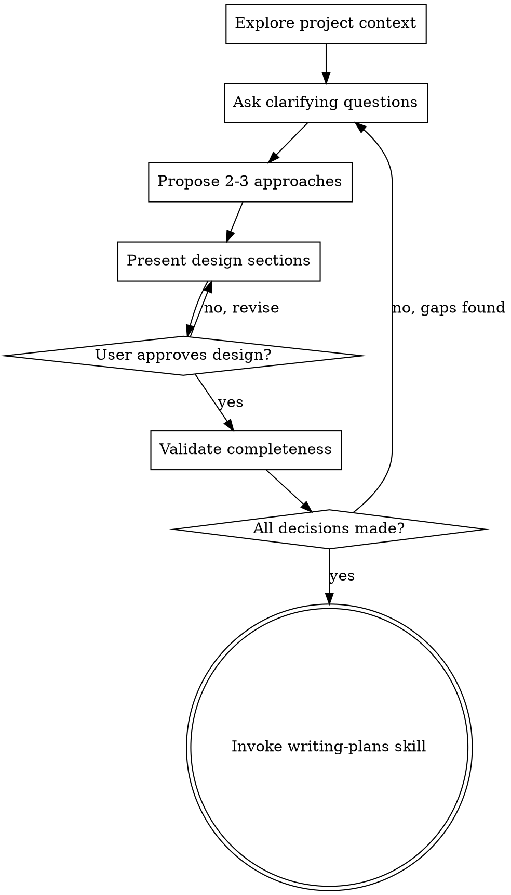

# Brainstorming Ideas Into Designs

## Overview

Help turn ideas into fully formed designs and specs through natural collaborative dialogue.

Start by understanding the current project context, then ask questions one at a time to refine the idea. Once you understand what you're building, present the design and get user approval.

<HARD-GATE>
Do NOT invoke any implementation skill, write any code, scaffold any project, or take any implementation action until you have presented a design and the user has approved it. This applies to EVERY project regardless of perceived simplicity.
</HARD-GATE>

## Anti-Pattern: "This Is Too Simple To Need A Design"

Every project goes through this process. A todo list, a single-function utility, a config change — all of them. "Simple" projects are where unexamined assumptions cause the most wasted work. The design can be short (a few sentences for truly simple projects), but you MUST present it and get approval.

## Checklist

You MUST create a task for each of these items and complete them in order:

1. **Explore project context** — check files, docs, recent commits
2. **Ask clarifying questions** — one at a time, understand purpose/constraints/success criteria
3. **Propose 2-3 approaches** — with trade-offs and your recommendation
4. **Present design** — in sections scaled to their complexity, get user approval after each section
5. **Validate design completeness** — ensure all decisions are made, no ambiguity remains
6. **Invoke writing-plans skill** — writing-plans will create design.md and invoke openspec-planning

## Process Flow

**The terminal state is invoking writing-plans.** Do NOT invoke frontend-design, mcp-builder, or any other implementation skill. The ONLY skill you invoke after brainstorming is writing-plans.

## The Process

**Understanding the idea:**
- Check out the current project state first (files, docs, recent commits)
- Ask questions one at a time to refine the idea
- Prefer multiple choice questions when possible, but open-ended is fine too
- Only one question per message - if a topic needs more exploration, break it into multiple questions
- Focus on understanding: purpose, constraints, success criteria

**Exploring approaches:**
- Propose 2-3 different approaches with trade-offs
- Present options conversationally with your recommendation and reasoning
- Lead with your recommended option and explain why

<HARD-GATE>
After presenting approaches, you MUST wait for the user to explicitly choose one. Do NOT proceed with implementation, do NOT assume the user wants your recommended option, and do NOT start executing any approach until the user has made their selection clear.
</HARD-GATE>

**Red flags - Self-selecting approaches:**
- "I'll go with Option A because..." → STOP, wait for user choice
- "Let me implement the recommended approach..." → STOP, wait for user choice
- Starting to write code or create files → STOP, no approval yet
- "Based on your requirements, I'm choosing..." → STOP, user must choose

**Presenting the design:**
- Once you believe you understand what you're building, present the design
- Scale each section to its complexity: a few sentences if straightforward, up to 200-300 words if nuanced
- Ask after each section whether it looks right so far
- Cover: architecture, components, data flow, error handling, testing
- Be ready to go back and clarify if something doesn't make sense

**Validating design completeness:**
Before writing the design doc, verify that ALL of the following are decided:
- [ ] All technical approaches are chosen (no "Option A or B" remaining)
- [ ] All data structures and schemas are defined
- [ ] All API contracts and interfaces are specified
- [ ] All error handling strategies are determined
- [ ] All dependencies and integrations are identified
- [ ] All performance/security requirements are addressed

If ANY item above is unclear or has multiple options, go back and ask the user to decide.

**Red flags that indicate incomplete design:**
- "We could use X or Y" → Ask user to choose
- "Depending on..." → Clarify the dependency
- "TBD", "TODO", "To be decided" → Resolve now
- "Maybe we should..." → Decide yes or no
- Multiple approaches listed without a final decision → Get user to pick one

## After the Design

**Documentation:**
- Invoke the writing-plans skill to create design document
- writing-plans will save to `openspec/changes/<change-id>/design.md`
- writing-plans will then automatically invoke openspec-planning

**Implementation:**
- Do NOT invoke any other skill besides writing-plans
- writing-plans is the ONLY next step after brainstorming

## Key Principles

- **One question at a time** - Don't overwhelm with multiple questions
- **Multiple choice preferred** - Easier to answer than open-ended when possible
- **YAGNI ruthlessly** - Remove unnecessary features from all designs
- **Explore alternatives** - Always propose 2-3 approaches before settling
- **Incremental validation** - Present design, get approval before moving on
- **Be flexible** - Go back and clarify when something doesn't make sense
