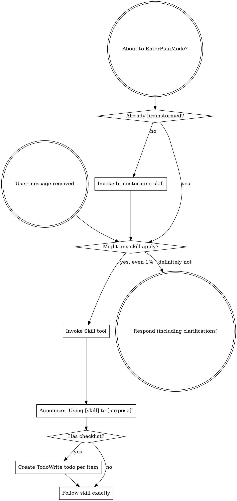
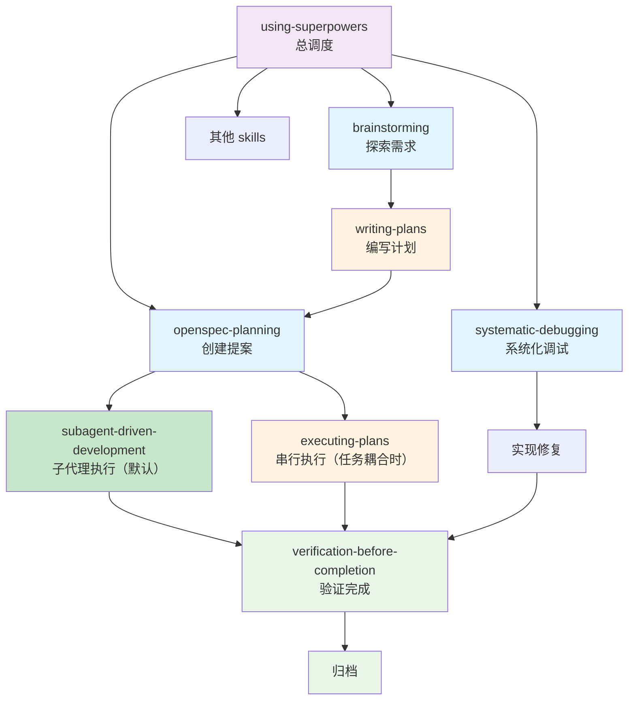

<EXTREMELY-IMPORTANT>
If you think there is even a 1% chance a skill might apply to what you are doing, you ABSOLUTELY MUST invoke the skill.

IF A SKILL APPLIES TO YOUR TASK, YOU DO NOT HAVE A CHOICE. YOU MUST USE IT.

This is not negotiable. This is not optional. You cannot rationalize your way out of this.
</EXTREMELY-IMPORTANT>

## How to Access Skills

**In Claude Code:** Use the `Skill` tool. When you invoke a skill, its content is loaded and presented to you—follow it directly. Never use the Read tool on skill files.

**In other environments:** Check your platform's documentation for how skills are loaded.

# Using Skills

## The Rule

**Invoke relevant or requested skills BEFORE any response or action.** Even a 1% chance a skill might apply means that you should invoke the skill to check. If an invoked skill turns out to be wrong for the situation, you don't need to use it.



## Red Flags

These thoughts mean STOP—you're rationalizing:

| Thought | Reality |
|---------|---------|
| "This is just a simple question" | Questions are tasks. Check for skills. |
| "I need more context first" | Skill check comes BEFORE clarifying questions. |
| "Let me explore the codebase first" | Skills tell you HOW to explore. Check first. |
| "I can check git/files quickly" | Files lack conversation context. Check for skills. |
| "Let me gather information first" | Skills tell you HOW to gather information. |
| "This doesn't need a formal skill" | If a skill exists, use it. |
| "I remember this skill" | Skills evolve. Read current version. |
| "This doesn't count as a task" | Action = task. Check for skills. |
| "The skill is overkill" | Simple things become complex. Use it. |
| "I'll just do this one thing first" | Check BEFORE doing anything. |
| "This feels productive" | Undisciplined action wastes time. Skills prevent this. |
| "I know what that means" | Knowing the concept ≠ using the skill. Invoke it. |

## Skill Priority

When multiple skills could apply, use this order:

1. **Process skills first** (brainstorming, debugging) - these determine HOW to approach the task
2. **Implementation skills second** (frontend-design, mcp-builder) - these guide execution

"Let's build X" → brainstorming first, then implementation skills.
"Fix this bug" → debugging first, then domain-specific skills.

## Common Scenarios Decision Table

| 用户说... | 需求明确？ | 调用顺序 |
|----------|-----------|---------|
| "实现 XX 功能" | 否 | `brainstorming` → `openspec-planning` → `subagent-driven-development` |
| "实现 XX 功能" | 是 | `openspec-planning` → `subagent-driven-development` |
| "添加 XX 模块" | 否 | `brainstorming` → `openspec-planning` → `subagent-driven-development` |
| "添加 XX 模块" | 是 | `openspec-planning` → `subagent-driven-development` |
| "修复 XX bug" | - | `systematic-debugging` → 实现（简单）或 `subagent-driven-development`（复杂） |
| "这个项目是做什么的" | - | 读取 `openspec/project.md` |
| "怎么写 Java 代码" | - | 读取 `openspec/project.md` § Java 规范 |
| "等我确认" | - | `openspec-planning` |
| "创建提案" | - | `openspec-planning` |
| "归档这个 change" | - | `verification-before-completion` → 归档 |

### 执行方式决策

**自动判断规则**：

读取 tasks.md 统计任务数量：
- **3+ 个任务** → 自动调用 `subagent-driven-development`
- **1-2 个任务** → 检查复杂度
  - 简单（单文件小改动）→ 主会话直接执行
  - 复杂（多文件或复杂逻辑）→ 调用 `subagent-driven-development`

**强制规则**：
- 禁止在主会话中逐个执行 3+ 个任务
- 禁止不调用子代理就开始实现多任务

**例外情况**：
- 用户明确说"不要用子代理" → 使用 `executing-plans`
- 用户明确说"串行执行" → 使用 `executing-plans`
- 任务高度耦合（后续任务依赖前面输出）→ 询问用户是否使用 `executing-plans`

**适用场景**：
子代理适用于：
- 多文件修改
- 批量重构
- 文档生成
- 测试编写
- 代码审查
- 数据迁移

### 判断"需求是否明确"

**需求明确**（直接 openspec-planning）：
- 用户提供了详细的功能描述
- 用户明确说明了技术方案
- 用户提供了设计文档或原型

**需求不明确**（先 brainstorming）：
- 用户只说了一个模糊的目标（"优化性能"、"改进用户体验"）
- 没有说明具体实现方式
- 可能有多种实现方案需要对比
- 你不确定用户的真实意图

**经验法则**：如果你需要问 2 个以上的澄清问题，先调用 `brainstorming`。

### brainstorming → openspec-planning 衔接

```
brainstorming 完成
  ↓
验证设计完整性（检查清单）
  ↓
有未决策项？
  ↓ 是
继续提问澄清，直到所有决策完成
  ↓ 否
自动调用 writing-plans skill
  ↓
输出设计文档到 openspec/changes/<change-id>/design.md
  ↓
自动调用 openspec-planning
  ↓
openspec-planning 检测到 design.md 已存在
  ↓
读取 design.md 并创建其他 OpenSpec 文件:
  - proposal.md
  - specs/<capability>/spec.md
  - tasks.md
  - design.md (已存在，保持不变)
  ↓
验证并等待用户批准
```

**关键点**：
- brainstorming 的最后一步是验证设计完整性
- 只有所有决策都完成后，才调用 `writing-plans` skill
- `writing-plans` 直接输出到 `openspec/changes/<change-id>/design.md`
- `openspec-planning` 检测到 design.md 存在，读取并创建其他文件

**验证清单**（两个 skill 都会检查）：
- [ ] 技术方案已选定（没有"可以用 A 或 B"）
- [ ] 数据结构和 schema 已定义
- [ ] API 接口和契约已明确
- [ ] 错误处理策略已确定
- [ ] 依赖和集成点已识别
- [ ] 性能/安全要求已明确

## 技能依赖关系图



**技能类型说明**：

| 类型 | 说明 | 示例 |
|------|------|------|
| 调度技能 | 决定调用哪个技能 | using-superpowers |
| Process 技能 | 决定如何处理任务 | brainstorming, systematic-debugging |
| Implementation 技能 | 指导执行 | writing-plans, executing-plans |
| Verification 技能 | 验证完成 | verification-before-completion |

**技能调用模式**：

- **终止技能**：不再调用其他技能
  - systematic-debugging（调试后直接实现）
  - requesting-code-review（审查后等待反馈）
  
- **中转技能**：会自动调用下一个技能
  - brainstorming → writing-plans
  - writing-plans → openspec-planning
  - executing-plans → verification-before-completion

## Skill Types

**Rigid** (TDD, debugging): Follow exactly. Don't adapt away discipline.

**Flexible** (patterns): Adapt principles to context.

The skill itself tells you which.

## User Instructions

Instructions say WHAT, not HOW. "Add X" or "Fix Y" doesn't mean skip workflows.

## 自检清单

完成任务前，Agent 必须确认：

### 技能调用检查
- [ ] 已调用 using-superpowers skill（本技能）
- [ ] 已按照 skill 指引执行
- [ ] 如果调用了其他 skill，已完整遵循其流程

### 任务完成检查
- [ ] 已完成所有 TODO 任务
- [ ] 已更新 tasks.md 状态（如适用）
- [ ] 已运行验证脚本（如适用）

### 文档和代码检查
- [ ] 已更新相关文档（如适用）
- [ ] 没有使用 emoji
- [ ] 没有创建临时文档（*_SUMMARY.md 等）
- [ ] 提交信息格式正确

### 验证命令
```bash
# 文档规范检查
./tools/validate-docs.sh

# 任务状态检查
./tools/validate-task-sync.sh

# OpenSpec 验证（如有 change）
openspec validate <change-id> --strict --no-interactive
```

**何时使用此清单**：
- 完成任务准备提交前
- 准备归档 OpenSpec change 前
- 用户要求验证工作完成度时
