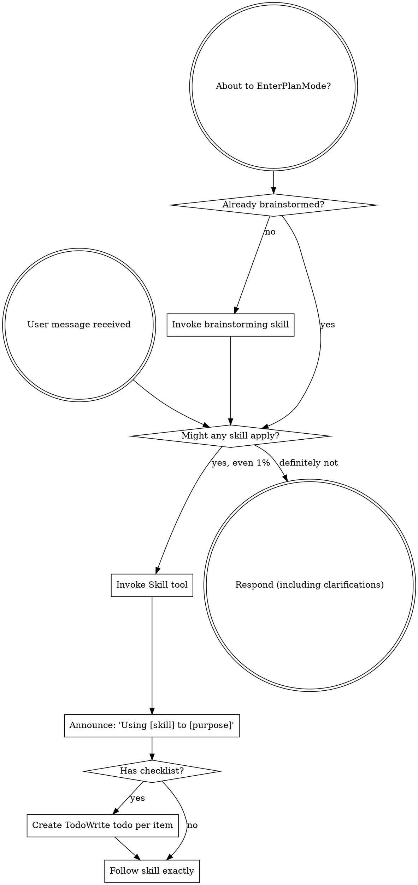

<EXTREMELY-IMPORTANT>
If you think there is even a 1% chance a skill might apply to what you are doing, you ABSOLUTELY MUST invoke the skill.

IF A SKILL APPLIES TO YOUR TASK, YOU DO NOT HAVE A CHOICE. YOU MUST USE IT.

This is not negotiable. This is not optional. You cannot rationalize your way out of this.
</EXTREMELY-IMPORTANT>

## How to Access Skills

**In Claude Code:** Use the `Skill` tool. When you invoke a skill, its content is loaded and presented to you—follow it directly. Never use the Read tool on skill files.

**In other environments:** Check your platform's documentation for how skills are loaded.

# Using Skills

## The Rule

**Invoke relevant or requested skills BEFORE any response or action.** Even a 1% chance a skill might apply means that you should invoke the skill to check. If an invoked skill turns out to be wrong for the situation, you don't need to use it.



## Red Flags

These thoughts mean STOP—you're rationalizing:

| Thought | Reality |
|---------|---------|
| "This is just a simple question" | Questions are tasks. Check for skills. |
| "I need more context first" | Skill check comes BEFORE clarifying questions. |
| "Let me explore the codebase first" | Skills tell you HOW to explore. Check first. |
| "I can check git/files quickly" | Files lack conversation context. Check for skills. |
| "Let me gather information first" | Skills tell you HOW to gather information. |
| "This doesn't need a formal skill" | If a skill exists, use it. |
| "I remember this skill" | Skills evolve. Read current version. |
| "This doesn't count as a task" | Action = task. Check for skills. |
| "The skill is overkill" | Simple things become complex. Use it. |
| "I'll just do this one thing first" | Check BEFORE doing anything. |
| "This feels productive" | Undisciplined action wastes time. Skills prevent this. |
| "I know what that means" | Knowing the concept ≠ using the skill. Invoke it. |

## Skill Priority

When multiple skills could apply, use this order:

1. **Process skills first** (brainstorming, debugging) - these determine HOW to approach the task
2. **Implementation skills second** (frontend-design, mcp-builder) - these guide execution

"Let's build X" → brainstorming first, then implementation skills.
"Fix this bug" → debugging first, then domain-specific skills.

## Common Scenarios Decision Table

| 用户说... | 需求明确？ | 调用顺序 |
|----------|-----------|---------|
| "实现 XX 功能" | 否 | `brainstorming` → `openspec-planning` → 实现 |
| "实现 XX 功能" | 是 | `openspec-planning` → 实现 |
| "添加 XX 模块" | 否 | `brainstorming` → `openspec-planning` → 实现 |
| "添加 XX 模块" | 是 | `openspec-planning` → 实现 |
| "修复 XX bug" | - | `systematic-debugging` → 实现 |
| "这个项目是做什么的" | - | 读取 `openspec/project.md` |
| "怎么写 Java 代码" | - | 读取 `openspec/project.md` § Java 规范 |
| "等我确认" | - | `openspec-planning` |
| "创建提案" | - | `openspec-planning` |
| "归档这个 change" | - | `verification-before-completion` → 归档 |

### 判断"需求是否明确"

**需求明确**（直接 openspec-planning）：
- 用户提供了详细的功能描述
- 用户明确说明了技术方案
- 用户提供了设计文档或原型

**需求不明确**（先 brainstorming）：
- 用户只说了一个模糊的目标（"优化性能"、"改进用户体验"）
- 没有说明具体实现方式
- 可能有多种实现方案需要对比
- 你不确定用户的真实意图

**经验法则**：如果你需要问 2 个以上的澄清问题，先调用 `brainstorming`。

### brainstorming → openspec-planning 衔接

```
brainstorming 完成
  ↓
输出设计文档到 docs/plans/YYYY-MM-DD-<topic>-design.md
  ↓
自动调用 openspec-planning
  ↓
openspec-planning 检测到最近的设计文档
  ↓
读取并转换为 OpenSpec 格式
  ↓
创建 changes/<change-id>/ 结构
  ↓
验证并等待用户批准
```

**关键点**：
- brainstorming 的最后一步是调用 `writing-plans` skill
- `writing-plans` 会输出到 `docs/plans/`
- `openspec-planning` 会自动检测并转换这个输出

## Skill Types

**Rigid** (TDD, debugging): Follow exactly. Don't adapt away discipline.

**Flexible** (patterns): Adapt principles to context.

The skill itself tells you which.

## User Instructions

Instructions say WHAT, not HOW. "Add X" or "Fix Y" doesn't mean skip workflows.
