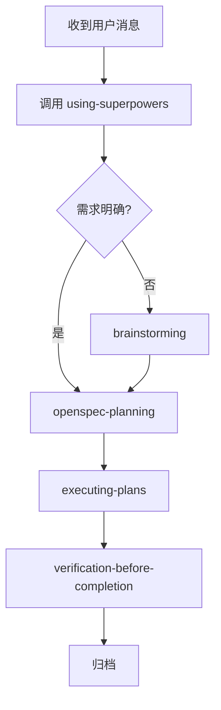
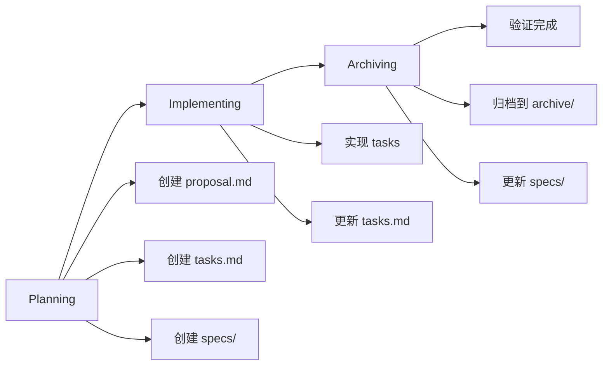
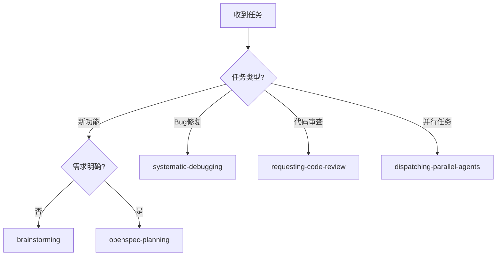
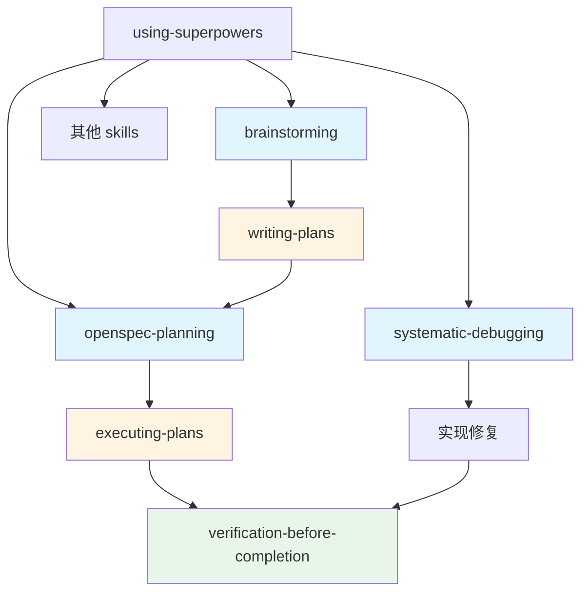

# Agent 规则、工作流和技能配置改进设计

<!-- 设计版本: v1.0.0 -->
<!-- 创建日期: 2026-03-06 -->
<!-- 设计者: AI Agent -->

## 背景

根据对当前项目 Agent 规则、工作流和技能配置的评审，识别出以下问题：

1. OpenSpec 结构不完整（migrate-szadmin-modules 缺少 specs/，archive 结构不规范）
2. 缺少自动化验证工具（commit message、任务状态同步）
3. 文档存在冗余（根目录 AGENTS.md 和 openspec/AGENTS.md 内容重复）
4. 技能依赖关系不明确
5. 归档时机和流程不清晰
6. 缺少技能调用自检机制

## 设计目标

通过渐进式改进，逐步解决上述问题，提升 Agent 工作流的规范性和可维护性。

## 整体架构

采用渐进式改进方案，将改进拆分为 4 个独立的 OpenSpec changes，按顺序实施：

```
Change 1: fix-openspec-structure
    ↓
Change 2: add-validation-tools
    ↓
Change 3: optimize-documentation
    ↓
Change 4: enhance-skill-config
```

每个 change 都是独立可验证的，可以单独测试和回滚。

## Change 1: fix-openspec-structure

### 目标
修复 OpenSpec 结构完整性问题

### 具体改进

#### 1.1 补充 migrate-szadmin-modules 的 specs/ 目录
- 创建 `openspec/changes/migrate-szadmin-modules/specs/` 目录
- 根据该 change 的实际内容，补充对应的 spec.md 文件
- 如果该 change 已完成，考虑归档

#### 1.2 规范 archive 目录结构
- 检查 `openspec/changes/archive/` 目录
- 确保每个归档的 change 都有完整结构：
  - `YYYY-MM-DD-<change-id>/proposal.md`
  - `YYYY-MM-DD-<change-id>/tasks.md`
  - `YYYY-MM-DD-<change-id>/specs/` 目录
- 如果是空目录或占位符，添加说明文档

#### 1.3 更新 validate-docs.sh
- 增强 OpenSpec 结构检查逻辑
- 区分"活跃 change"和"归档 change"的验证规则
- 归档的 change 允许缺少某些文件（如果已合并到 specs/）

### 验证方式
- 运行 `./tools/validate-docs.sh` 应该没有警告
- 运行 `openspec list` 和 `openspec list --specs` 应该正常工作

### 影响范围
- `openspec/changes/migrate-szadmin-modules/`
- `openspec/changes/archive/`
- `tools/validate-docs.sh`

---

## Change 2: add-validation-tools

### 目标
增加自动化验证工具，确保规则被正确执行

### 具体改进

#### 2.1 Git commit message 验证（pre-commit hook）
- 创建 `.git/hooks/commit-msg` 脚本
- 验证格式：`feat(模块): 中文内容` 或 `fix(模块): 中文内容`
- 支持的类型：feat, fix, docs, refactor, test, chore
- 拒绝包含 emoji 的提交信息
- 提供友好的错误提示

**脚本示例**：
```bash
#!/bin/bash
commit_msg=$(cat "$1")

# 检查格式
if ! echo "$commit_msg" | grep -qE '^(feat|fix|docs|refactor|test|chore)\([^)]+\): .+$'; then
    echo "错误：提交信息格式不正确"
    echo "正确格式：feat(模块): 中文内容"
    exit 1
fi

# 检查 emoji
if echo "$commit_msg" | grep -qP '[\x{1F300}-\x{1F9FF}]'; then
    echo "错误：提交信息不能包含 emoji"
    exit 1
fi
```

#### 2.2 任务状态同步验证脚本
- 创建 `tools/validate-task-sync.sh`
- 检查 `openspec/changes/*/tasks.md` 中的任务状态
- 输出未完成的任务列表
- 集成到 `tools/validate-docs.sh` 中

**脚本功能**：
```bash
# 检查所有活跃 change 的 tasks.md
# 统计未完成任务数量
# 输出格式：
# [change-id] 未完成任务: 3/10
```

#### 2.3 OpenSpec 结构完整性检查增强
- 更新 `tools/validate-docs.sh`
- 检查活跃 change 必须有：proposal.md, tasks.md, specs/
- 检查归档 change 的日期格式：YYYY-MM-DD-<change-id>
- 检查 spec.md 文件格式（必须有 Scenario）
- 提供修复建议

### 验证方式
- 尝试提交错误格式的 commit message，应该被拒绝
- 运行 `./tools/validate-task-sync.sh` 检查任务同步
- 运行 `./tools/validate-docs.sh` 应该通过所有检查

### 影响范围
- `.git/hooks/commit-msg`（新增）
- `tools/validate-task-sync.sh`（新增）
- `tools/validate-docs.sh`（更新）

---

## Change 3: optimize-documentation

### 目标
优化文档结构，消除冗余，增强可读性

### 具体改进

#### 3.1 简化根目录 AGENTS.md
**保留内容**：
- 强制规则（5 条）
- 自我检查清单
- 反模式警告表
- 常用 Skills 速查表
- 常用文档速查表

**移除内容**：
- 详细工作流说明（移到 openspec/AGENTS.md）
- Skill 优先级详解（移到 openspec/AGENTS.md）

**新增内容**：
- 指向 openspec/AGENTS.md 的引用链接
- "何时阅读详细文档"的说明

**目标**：控制在 100 行以内，作为快速参考

#### 3.2 增强 openspec/AGENTS.md
**新增 Mermaid 流程图**：

1. 整体工作流图：


2. OpenSpec 三阶段流程图：


3. 技能决策树：


**保留内容**：
- 所有详细说明和示例
- CLI 命令参考
- 故障排查指南

**新增内容**：
- "何时阅读本文档"的说明（按需参考）
- 流程图说明

#### 3.3 统一文档版本管理
在关键文档头部增加版本信息：

```markdown
<!-- 规范版本: v1.0.0 -->
<!-- 最后更新: 2026-03-06 -->
<!-- 维护者: 开发团队 -->
```

**需要增加版本号的文档**：
- `AGENTS.md`（新增 v1.0.0）
- `openspec/AGENTS.md`（新增 v1.0.0）
- `openspec/DOCUMENTATION.md`（新增 v1.0.0）
- `openspec/project.md`（已有 v1.0.0，保持）

**版本号规则**：
- 主版本号（1.x.x）：破坏性变更
- 次版本号（x.1.x）：新增规范
- 修订号（x.x.1）：澄清或修正

在 `openspec/CHANGELOG.md` 中记录版本变更。

### 验证方式
- 根目录 AGENTS.md 应该在 100 行左右
- 所有 Mermaid 图表应该能正确渲染
- 关键文档都有版本号

### 影响范围
- `AGENTS.md`（简化）
- `openspec/AGENTS.md`（增强）
- `openspec/DOCUMENTATION.md`（增加版本号）
- `openspec/CHANGELOG.md`（记录变更）

---

## Change 4: enhance-skill-config

### 目标
增强技能配置，明确依赖关系和使用规范

### 具体改进

#### 4.1 在 using-superpowers skill 中增加技能依赖关系图

**技能依赖关系图**：


**图例说明**：
- 蓝色：Process skills（决定如何做）
- 黄色：Implementation skills（指导执行）
- 绿色：Verification skills（验证完成）

**技能类型标注**：
- 终止技能：不再调用其他技能（如 systematic-debugging）
- 中转技能：会调用下一个技能（如 brainstorming → writing-plans）

#### 4.2 明确归档时机和流程

**归档决策表**：

| 条件 | 是否归档 | 说明 |
|------|---------|------|
| 代码已合并到主分支 | 必须 | 代码已进入生产 |
| 所有测试通过 | 必须 | 质量保证 |
| 功能已部署到生产环境 | 必须 | 用户可用 |
| 仅文档变更（无需部署） | 可以 | 文档已更新 |
| 实验性功能（未合并） | 不归档 | 保留在 changes/ |

**归档前检查清单**：
```markdown
- [ ] tasks.md 所有任务标记为 [x]
- [ ] 运行 openspec validate --strict --no-interactive 通过
- [ ] 更新相关的 specs/ 文件
- [ ] 代码已合并到主分支（如有代码变更）
- [ ] 所有测试通过（如有代码变更）
- [ ] 功能已部署或明确不需要部署
```

**归档命令**：
```bash
openspec archive <change-id> --yes
```

#### 4.3 增加技能调用自检机制

**在 using-superpowers skill 中增加自检清单**：
```markdown
## 自检清单

完成任务前，确认：
- [ ] 已调用 using-superpowers skill
- [ ] 已按照 skill 指引执行
- [ ] 已完成所有 TODO 任务
- [ ] 已运行验证脚本（如适用）
- [ ] 已更新相关文档（如适用）
```

**在 AGENTS.md 的"自我检查清单"中增加**：
```bash
# 5. 检查技能调用（如适用）
# 确认是否调用了 using-superpowers
# 确认是否按照 skill 指引执行
```

### 验证方式
- 技能依赖关系图应该清晰易懂
- 归档决策表应该覆盖所有场景
- 自检清单应该可操作

### 影响范围
- `.opencode/skills/using-superpowers/SKILL.md`（更新）
- `openspec/AGENTS.md`（更新）
- `AGENTS.md`（更新自检清单）

---

## 实施顺序

1. **Change 1: fix-openspec-structure**（预计 1-2 天）
   - 补充缺失的 OpenSpec 结构
   - 更新验证脚本

2. **Change 2: add-validation-tools**（预计 2-3 天）
   - 创建 commit message 验证 hook
   - 创建任务状态同步验证脚本
   - 增强 OpenSpec 结构检查

3. **Change 3: optimize-documentation**（预计 2-3 天）
   - 简化根目录 AGENTS.md
   - 增强 openspec/AGENTS.md
   - 统一文档版本管理

4. **Change 4: enhance-skill-config**（预计 2-3 天）
   - 增加技能依赖关系图
   - 明确归档时机和流程
   - 增加技能调用自检机制

**总预计时间**：7-11 天

---

## 风险与缓解

### 风险 1：验证工具误报
**缓解措施**：
- 提供详细的错误提示和修复建议
- 允许通过参数跳过某些检查（如 --skip-xxx）
- 充分测试验证脚本

### 风险 2：文档简化导致信息丢失
**缓解措施**：
- 所有内容都保留在 openspec/AGENTS.md 中
- 根目录 AGENTS.md 提供明确的引用链接
- 在简化前备份原文档

### 风险 3：技能依赖关系图过于复杂
**缓解措施**：
- 只展示核心技能的依赖关系
- 使用颜色和图例增强可读性
- 提供文字说明补充图表

---

## 成功标准

1. 运行 `./tools/validate-docs.sh` 没有警告
2. 所有验证工具正常工作
3. 根目录 AGENTS.md 控制在 100 行以内
4. 所有 Mermaid 图表能正确渲染
5. 关键文档都有版本号
6. 技能依赖关系清晰明确
7. 归档流程有明确的决策表和检查清单

---

## 后续改进（长期）

以下改进项不在本次设计范围内，可作为后续优化方向：

1. 技能使用统计和分析
2. 规则执行追踪机制
3. CI/CD 流程验证
4. 规范变更影响分析

---

## 总结

本设计采用渐进式改进方案，通过 4 个独立的 OpenSpec changes，逐步解决当前 Agent 规则、工作流和技能配置中的问题。每个 change 都是独立可验证的，风险可控，符合 OpenSpec 的变更管理理念。

预计完成后，Agent 工作流的规范性和可维护性将得到显著提升。
