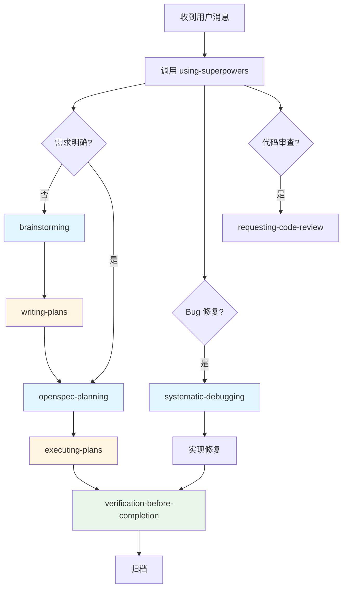
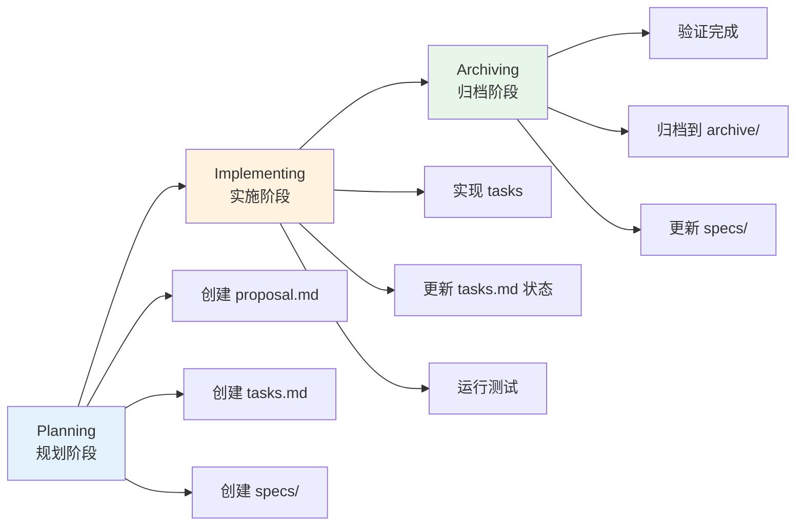
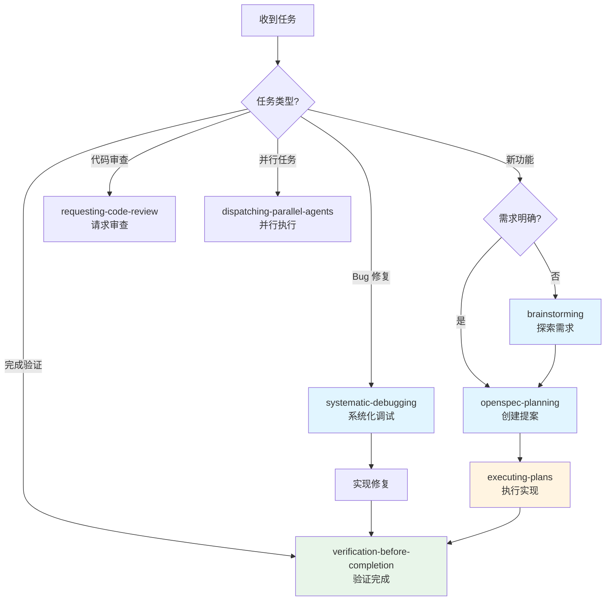
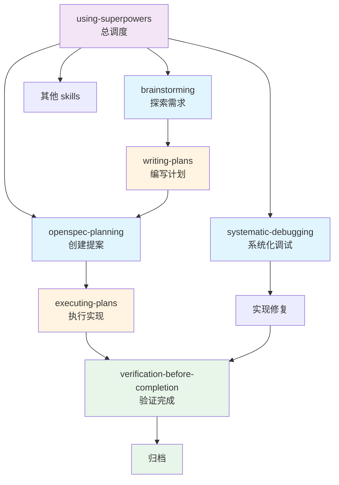

# Agent 改进实施计划

> **For Claude:** REQUIRED SUB-SKILL: Use openspec-planning to implement this plan task-by-task.

**目标：** 通过 4 个独立的 OpenSpec changes，渐进式改进 Agent 规则、工作流和技能配置

**架构：** 每个 change 独立可验证，按顺序实施，风险可控

**技术栈：** Bash 脚本、Markdown 文档、Mermaid 图表、Git hooks

---

## Change 1: fix-openspec-structure

### 任务 1.1：检查 migrate-szadmin-modules 状态

**文件：**
- 检查：`openspec/changes/migrate-szadmin-modules/`

**步骤 1：检查目录结构**
```bash
ls -la openspec/changes/migrate-szadmin-modules/
```

**步骤 2：判断是否需要归档**
- 如果 tasks.md 所有任务已完成 → 归档
- 如果仍在进行中 → 补充 specs/

**步骤 3：记录决策**
记录在实施过程中的决策（归档或补充）

---

### 任务 1.2：补充或归档 migrate-szadmin-modules

**场景 A：需要归档**

**步骤 1：运行归档命令**
```bash
openspec archive migrate-szadmin-modules --yes
```

**步骤 2：验证归档**
```bash
ls -la openspec/changes/archive/ | grep migrate-szadmin-modules
```

**步骤 3：提交**
```bash
git add openspec/changes/
git commit -m "chore(openspec): 归档 migrate-szadmin-modules"
```

**场景 B：需要补充 specs/**

**步骤 1：创建 specs 目录**
```bash
mkdir -p openspec/changes/migrate-szadmin-modules/specs/module-migration
```

**步骤 2：创建 spec.md**
创建：`openspec/changes/migrate-szadmin-modules/specs/module-migration/spec.md`

内容：
```markdown
## ADDED Requirements

### Requirement: 模块迁移支持
系统 SHALL 支持从旧架构迁移到新架构

#### Scenario: 迁移成功
- GIVEN 存在旧模块结构
- WHEN 执行迁移脚本
- THEN 新模块结构创建成功
```

**步骤 3：验证**
```bash
openspec validate migrate-szadmin-modules --strict --no-interactive
```

**步骤 4：提交**
```bash
git add openspec/changes/migrate-szadmin-modules/
git commit -m "docs(openspec): 补充 migrate-szadmin-modules specs"
```

---

### 任务 1.3：规范 archive 目录

**文件：**
- 检查：`openspec/changes/archive/`

**步骤 1：列出 archive 内容**
```bash
ls -la openspec/changes/archive/
```

**步骤 2：检查每个归档项**
对于每个归档目录，检查是否有：
- proposal.md
- tasks.md
- specs/ 目录

**步骤 3：创建 README（如果 archive 为空）**
如果 archive 是空目录，创建：`openspec/changes/archive/README.md`

内容：
```markdown
# 归档变更

本目录存放已完成的 OpenSpec changes。

## 目录结构

每个归档的 change 应该有以下结构：
- YYYY-MM-DD-<change-id>/proposal.md
- YYYY-MM-DD-<change-id>/tasks.md
- YYYY-MM-DD-<change-id>/specs/

## 归档流程

使用命令：openspec archive <change-id> --yes
```

**步骤 4：提交**
```bash
git add openspec/changes/archive/
git commit -m "docs(openspec): 规范 archive 目录结构"
```

---

### 任务 1.4：更新 validate-docs.sh

**文件：**
- 修改：`tools/validate-docs.sh`

**步骤 1：备份原文件**
```bash
cp tools/validate-docs.sh tools/validate-docs.sh.bak
```

**步骤 2：增强 OpenSpec 检查逻辑**
在 validate-docs.sh 中找到 OpenSpec 检查部分，修改为：

```bash
# 检查活跃 changes
for change_dir in openspec/changes/*/; do
    if [[ "$change_dir" == *"/archive/"* ]]; then
        continue
    fi
    
    change_name=$(basename "$change_dir")
    
    # 检查必需文件
    if [[ ! -f "$change_dir/proposal.md" ]]; then
        echo "   [警告] $change_name 缺少 proposal.md"
    fi
    
    if [[ ! -f "$change_dir/tasks.md" ]]; then
        echo "   [警告] $change_name 缺少 tasks.md"
    fi
    
    if [[ ! -d "$change_dir/specs" ]]; then
        echo "   [警告] $change_name 缺少 specs/ 目录"
    fi
done

# 检查归档 changes 的日期格式
for archive_dir in openspec/changes/archive/*/; do
    if [[ ! -d "$archive_dir" ]]; then
        continue
    fi
    
    archive_name=$(basename "$archive_dir")
    
    # 检查日期格式 YYYY-MM-DD-*
    if ! echo "$archive_name" | grep -qE '^[0-9]{4}-[0-9]{2}-[0-9]{2}-'; then
        echo "   [警告] 归档 $archive_name 日期格式不正确（应为 YYYY-MM-DD-<change-id>）"
    fi
done
```

**步骤 3：测试脚本**
```bash
./tools/validate-docs.sh
```

**步骤 4：提交**
```bash
git add tools/validate-docs.sh
git commit -m "feat(tools): 增强 OpenSpec 结构验证"
```

---

### 任务 1.5：验证 Change 1 完成

**步骤 1：运行验证**
```bash
./tools/validate-docs.sh
```
预期：没有关于 OpenSpec 结构的警告

**步骤 2：运行 OpenSpec 命令**
```bash
openspec list
openspec list --specs
```
预期：正常输出，没有错误

**步骤 3：记录完成**
Change 1 完成

---

## Change 2: add-validation-tools

### 任务 2.1：创建 commit message 验证 hook

**文件：**
- 创建：`.git/hooks/commit-msg`

**步骤 1：创建 hook 脚本**
```bash
cat > .git/hooks/commit-msg << 'EOF'
#!/bin/bash

commit_msg=$(cat "$1")

# 检查格式：type(scope): message
if ! echo "$commit_msg" | grep -qE '^(feat|fix|docs|refactor|test|chore)\([^)]+\): .+$'; then
    echo "错误：提交信息格式不正确"
    echo "正确格式：feat(模块): 中文内容"
    echo "支持的类型：feat, fix, docs, refactor, test, chore"
    exit 1
fi

# 检查是否包含 emoji（Unicode 范围）
if echo "$commit_msg" | grep -qP '[\x{1F300}-\x{1F9FF}]|\x{2600}-\x{26FF}|\x{2700}-\x{27BF}'; then
    echo "错误：提交信息不能包含 emoji"
    exit 1
fi

exit 0
EOF
```

**步骤 2：设置执行权限**
```bash
chmod +x .git/hooks/commit-msg
```

**步骤 3：测试 hook（错误格式）**
```bash
echo "test" | git commit --allow-empty -F -
```
预期：被拒绝，显示错误信息

**步骤 4：测试 hook（正确格式）**
```bash
git commit --allow-empty -m "test(validation): 测试提交验证"
```
预期：成功提交

**步骤 5：删除测试提交**
```bash
git reset --soft HEAD~1
```

---

### 任务 2.2：创建任务状态同步验证脚本

**文件：**
- 创建：`tools/validate-task-sync.sh`

**步骤 1：创建脚本**
```bash
cat > tools/validate-task-sync.sh << 'EOF'
#!/bin/bash

echo "检查任务状态同步..."

total_changes=0
total_tasks=0
completed_tasks=0

# 遍历所有活跃 changes
for change_dir in openspec/changes/*/; do
    if [[ "$change_dir" == *"/archive/"* ]]; then
        continue
    fi
    
    if [[ ! -f "$change_dir/tasks.md" ]]; then
        continue
    fi
    
    change_name=$(basename "$change_dir")
    total_changes=$((total_changes + 1))
    
    # 统计任务
    tasks=$(grep -c "^- \[" "$change_dir/tasks.md" 2>/dev/null || echo 0)
    completed=$(grep -c "^- \[x\]" "$change_dir/tasks.md" 2>/dev/null || echo 0)
    
    total_tasks=$((total_tasks + tasks))
    completed_tasks=$((completed_tasks + completed))
    
    if [[ $tasks -gt 0 ]]; then
        pending=$((tasks - completed))
        echo "   [$change_name] 任务进度: $completed/$tasks 完成"
        
        if [[ $pending -gt 0 ]]; then
            echo "      未完成任务: $pending"
        fi
    fi
done

echo ""
echo "总计: $total_changes 个活跃 change, $completed_tasks/$total_tasks 任务完成"

if [[ $total_tasks -eq $completed_tasks ]]; then
    echo "[通过] 所有任务已完成"
else
    echo "[提示] 还有 $((total_tasks - completed_tasks)) 个任务未完成"
fi
EOF
```

**步骤 2：设置执行权限**
```bash
chmod +x tools/validate-task-sync.sh
```

**步骤 3：测试脚本**
```bash
./tools/validate-task-sync.sh
```
预期：显示任务统计信息

**步骤 4：提交**
```bash
git add tools/validate-task-sync.sh
git commit -m "feat(tools): 添加任务状态同步验证脚本"
```

---

### 任务 2.3：集成到 validate-docs.sh

**文件：**
- 修改：`tools/validate-docs.sh`

**步骤 1：在 validate-docs.sh 末尾添加**
```bash
# 在文件末尾添加
echo ""
echo "5. 检查任务状态..."
./tools/validate-task-sync.sh
```

**步骤 2：测试集成**
```bash
./tools/validate-docs.sh
```
预期：包含任务状态检查

**步骤 3：提交**
```bash
git add tools/validate-docs.sh
gitm "feat(tools): 集成任务状态检查到文档验证"
```

---

### 任务 2.4：增强 OpenSpec 结构检查

**文件：**
- 修改：`tools/validate-docs.sh`

**步骤 1：添加 spec.md 格式检查**
在 validate-docs.sh 的 OpenSpec 检查部分添加：

```bash
# 检查 spec.md 格式
for spec_file in openspec/changes/*/specs/*/spec.md; do
    if [[ ! -f "$spec_file" ]]; then
        continue
    fi
    
    # 检查是否有 Scenario
    if ! grep -q "^#### Scenario:" "$spec_file"; then
        echo "   [警告] $spec_file 缺少 Scenario"
    fi
    
    # 检查是否有 delta 操作
    if ! grep -qE "^## (ADDED|MODIFIED|REMOVED|RENAMED) Requirements" "$spec_file"; then
        echo "   [警告] $spec_file 缺少 delta 操作标记"
    fi
done
```

**步骤 2：测试检查**
```bash
./tools/validate-docs.sh
```

**步骤 3：提交**
```bash
git add tools/validate-docs.sh
git commit -m "feat(tools): 增强 spec.md 格式检查"
```

---

### 任务 2.5：创建验证工具文档

**文件：**
- 创建：`tools/README.md`

**步骤 1：创建文档**
```markdown
# 验证工具

## validate-docs.sh

检查文档规范合规性。

运行：
```bash
./tools/validate-docs.sh
```

检查项：
- emoji 使用
- 禁止的文档类型
- OpenSpec 结构完整性
- spec.md 格式
- 任务状态同步

## validate-task-sync.sh

检查 OpenSpec changes 的任务完成状态。

运行：
```bash
./tools/validate-task-sync.sh
```

输出：
- 每个 change 的任务进度
- 总体任务统计

## commit-msg hook

Git commit message 格式验证。

格式：`type(scope): message`

支持的类型：
- feat: 新功能
- fix: Bug 修复
- docs: 文档变更
- refactor: 重构
- test: 测试
- chore: 构建/工具变更

规则：
- 必须包含中文内容
- 禁止使用 emoji
```

**步骤 2：提交**
```bash
git add tools/README.md
git commit -m "docs(tools): 添加验证工具文档"
```

---

### 任务 2.6：验证 Change 2 完成

**步骤 1：测试 commit hook**
```bash
# 测试错误格式
echo "invalid" | git commit --allow-empty -F - 2>&1 | grep "错误"
```
预期：显示错误信息

**步骤 2：运行所有验证**
```bash
./tools/validate-docs.sh
./tools/validate-task-sync.sh
```
预期：正常运行

**步骤 3：记录完成**
Change 2 完成

---

## Change 3: optimize-documentation

### 任务 3.1：简化根目录 AGENTS.md

**文件：**
- 修改：`AGENTS.md`

**步骤 1：备份原文件**
```bash
cp AGENTS.md AGENTS.md.bak
```

**步骤 2：创建简化版本**
保留内容：
- 强制规则（5 条）
- 自我检查清单
- 反模式警告表
- 常用 Skills 速查表
- 常用文档速查表

移除内容：
- 详细工作流说明
- Skill 优先级详解
- Skill 类型说明

**步骤 3：添加版本信息和引用**
在文件头部添加：
```markdown
<!-- 规范版本: v1.0.0 -->
<!-- 最后更新: 2026-03-06 -->
<!-- 维护者: 开发团队 -->

> **详细文档**：完整的工作流程和技能说明请参考 `openspec/AGENTS.md`
```

**步骤 4：验证行数**
```bash
wc -l AGENTS.md
```
预期：约 100 行左右

**步骤 5：提交**
```bash
git add AGENTS.md
git commit -m "docs(agent): 简化根目录 AGENTS.md"
```

---

### 任务 3.2：增强 openspec/AGENTS.md - 添加版本信息

**文件：**
- 修改：`openspec/AGENTS.md`

**步骤 1：添加版本信息**
在文件头部添加：
```markdown
# OpenSpec Reference

<!-- 规范版本: v1.0.0 -->
<!-- 最后更新: 2026-03-06 -->
<!-- 维护者: 开发团队 -->

> **Note**: 本文档为按需参考，agent 默认不读取。使用 `openspec-planning` skill 开始工作流，遇到具体问题时再用 Read 工具读取本文档的相关章节。
```

**步骤 2：提交**
```bash
git add openspec/AGENTS.md
git commit -m "docs(openspec): 添加版本信息到 AGENTS.md"
```

---

### 任务 3.3：增强 openspec/AGENTS.md - 添加整体工作流图

**文件：**
- 修改：`openspec/AGENTS.md`

**步骤 1：在 Quick Reference 后添加工作流图**
```markdown
## 工作流程图

### 整体工作流



**图例说明**：
- 蓝色：Process skills（决定如何做）
- 黄色：Implementation skills（指导执行）
- 绿色：Verification skills（验证完成）
```

**步骤 2：提交**
```bash
git add openspec/AGENTS.md
git commit -m "docs(openspec): 添加整体工作流程图"
```

---

### 任务 3.4：增强 openspec/AGENTS.md - 添加 OpenSpec 三阶段流程图

**文件：**
- 修改：`openspec/AGENTS.md`

**步骤 1：在工作流程图部分添加**
```markdown
### OpenSpec 三阶段流程



**阶段说明**：
- Planning：创建变更提案，定义需求和任务
- Implementing：按 tasks.md 执行实现
- Archiving：验证完成后归档，更新规范
```

**步骤 2：提交**
```bash
git add openspec/AGENTS.md
git commit -m "docs(openspec): 添加 OpenSpec 三阶段流程图"
```

---

### 任务 3.5：增强 openspec/AGENTS.md - 添加技能决策树

**文件：**
- 修改：`openspec/AGENTS.md`

**步骤 1：在工作流程图部分添加**
```markdown
### 技能决策树



**决策说明**：
- 新功能：需求不明确先 brainstorming，明确则直接 openspec-planning
- Bug 修复：使用 systematic-debugging 系统化分析
- 代码审查：使用 requesting-code-review
- 并行任务：使用 dispatching-parallel-agents
- 完成验证：使用 verification-before-completion
```

**步骤 2：提交**
```bash
git add openspec/AGENTS.md
git commit -m "docs(openspec): 添加技能决策树"
```

---

### 任务 3.6：为 openspec/DOCUMENTATION.md 添加版本信息

**文件：**
- 修改：`openspec/DOCUMENTATION.md`

**步骤 1：添加版本信息**
在文件头部添加：
```markdown
# 文档组织规范

<!-- 规范版本: v1.0.0 -->
<!-- 最后更新: 2026-03-06 -->
<!-- 维护者: 开发团队 -->
```

**步骤 2：提交**
```bash
git add openspec/DOCUMENTATION.md
git commit -m "docs(openspec): 添加版本信息到 DOCUMENTATION.md"
```

---

### 任务 3.7：更新 openspec/CHANGELOG.md

**文件：**
- 修改：`openspec/CHANGELOG.md`

**步骤 1：添加版本记录**
在 CHANGELOG.md 顶部添加：
```markdown
## [1.0.0] - 2026-03-06

### Added
- 为关键文档添加版本管理（AGENTS.md, openspec/AGENTS.md, openspec/DOCUMENTATION.md）
- 在 openspec/AGENTS.md 中添加 Mermaid 工作流程图
- 添加整体工作流图、OpenSpec 三阶段流程图、技能决策树

### Changed
- 简化根目录 AGENTS.md，保留核心规则和速查表
- 将详细工作流说明移至 openspec/AGENTS.md

### Improved
- 文档结构更清晰，减少冗余
- 流程图增强可读性
```

**步骤 2：提交**
```bash
git add openspec/CHANGELOG.md
git commit -m "docs(openspec): 更新 CHANGELOG 记录版本 1.0.0"
```

---

### 任务 3.8：验证 Change 3 完成

**步骤 1：检查根目录 AGENTS.md 行数**
```bash
wc -l AGENTS.md
```
预期：约 100 行左右

**步骤 2：验证 Mermaid 图表**
在 Markdown 预览中查看 openspec/AGENTS.md，确认所有图表正确渲染

**步骤 3：检查版本信息**
```bash
grep "规范版本" AGENTS.md openspec/AGENTS.md openspec/DOCUMENTATION.md
```
预期：所有文件都有版本号

**步骤 4：记录完成**
Change 3 完成

---

## Change 4: enhance-skill-config

### 任务 4.1：在 using-superpowers skill 中添加技能依赖关系图

**文件：**
- 修改：`.opencode/skills/using-superpowers/SKILL.md`

**步骤 1：在 Common Scenarios Decision Table 后添加**
```markdown
## 技能依赖关系图



**技能类型说明**：

| 类型 | 说明 | 示例 |
|------|------|------|
| 调度技能 | 决定调用哪个技能 | using-superpowers |
| Process 技能 | 决定如何处理任务 | brainstorming, systematic-debugging |
| Implementation 技能 | 指导执行 | writing-plans, executing-plans |
| Verification 技能 | 验证完成 | verification-before-completion |

**技能调用模式**：

- **终止技能**：不再调用其他技能
  - systematic-debugging（调试后直接实现）
  - requesting-code-review（审查后等待反馈）
  
- **中转技能**：会自动调用下一个技能
  - brainstorming → writing-plans
  - writing-plans → openspec-planning
  - executing-plans → verification-before-completion
```

**步骤 2：提交**
```bash
git add .opencode/skills/using-superpowers/SKILL.md
git commit -m "docs(skill): 添加技能依赖关系图到 using-superpowers"
```

---

### 任务 4.2：在 openspec/AGENTS.md 中添加归档决策表

**文件：**
- 修改：`openspec/AGENTS.md`

**步骤 1：在 Stage 3: Archiving Changes 部分添加**
```markdown
### 归档决策表

| 条件 | 是否归档 | 说明 |
|------|---------|------|
| 代码已合并到主分支 | 必须 | 代码已进入生产 |
| 所有测试通过 | 必须 | 质量保证 |
| 功能已部署到生产环境 | 必须 | 用户可用 |
| 仅文档变更（无需部署） | 可以 | 文档已更新 |
| 实验性功能（未合并） | 不归档 | 保留在 changes/ |
| tasks.md 有未完成任务 | 不归档 | 先完成所有任务 |

### 归档前检查清单

在运行 `openspec archive` 前，确认：

```markdown
- [ ] tasks.md 所有任务标记为 [x]
- [ ] 运行 openspec validate --strict --no-interactive 通过
- [ ] 更新相关的 specs/ 文件
- [ ] 代码已合并到主分支（如有代码变更）
- [ ] 所有测试通过（如有代码变更）
- [ ] 功能已部署或明确不需要部署
- [ ] 运行 ./tools/validate-docs.sh 通过
```

### 归档命令

```bash
# 归档指定 change
openspec archive <change-id> --yes

# 验证归档结果
openspec validate --strict --no-interactive
ls -la openspec/changes/archive/ | grep <change-id>
```

### 归档后操作

1. 更新 `openspec/specs/` 中的相关规范
2. 在 `openspec/CHANGELOG.md` 中记录变更
3. 提交归档变更：
```bash
git add openspec/
git commit -m "chore(openspec): 归档 <change-id>"
```
```

**步骤 2：提交**
```bash
git add openspec/AGENTS.md
git commit -m "docs(openspec): 添加归档决策表和检查清单"
```

---

### 任务 4.3：在 using-superpowers skill 中添加自检清单

**文件：**
- 修改：`.opencode/skills/using-superpowers/SKILL.md`

**步骤 1：在文件末尾添加**
```markdown
## 自检清单

完成任务前，Agent 必须确认：

### 技能调用检查
- [ ] 已调用 using-superpowers skill（本技能）
- [ ] 已按照 skill 指引执行
- [ ] 如果调用了其他 skill，已完整遵循其流程

### 任务完成检查
- [ ] 已完成所有 TODO 任务
- [ ] 已更新 tasks.md 状态（如适用）
- [ ] 已运行验证脚本（如适用）

### 文档和代码检查
- [ ] 已更新相关文档（如适用）
- [ ] 没有使用 emoji
- [ ] 没有创建临时文档（*_SUMMARY.md 等）
- [ ] 提交信息格式正确

### 验证命令
```bash
# 文档规范检查
./tools/validate-docs.sh

# 任务状态检查
./tools/validate-task-sync.sh

# OpenSpec 验证（如有 change）
openspec validate <change-id> --strict --no-interactive
```

**何时使用此清单**：
- 完成任务准备提交前
- 准备归档 OpenSpec change 前
- 用户要求验证工作完成度时
```

**步骤 2：提交**
```bash
git add .opencode/skills/using-superpowers/SKILL.md
git commit -m "docs(skill): 添加自检清单到 using-superpowers"
```

---

### 任务 4.4：更新 AGENTS.md 的自我检查清单

**文件：**
- 修改：`AGENTS.md`

**步骤 1：在"自我检查清单"部分添加**
```bash
# 5. 检查技能调用（如适用）
# 确认是否调用了 using-superpowers
# 确认是否按照 skill 指引执行
grep -r "using-superpowers" .opencode/skills/
```

**步骤 2：提交**
```bash
git add AGENTS.md
git commit -m "docs(agent): 更新自我检查清单"
```

---

### 任务 4.5：创建技能使用指南

**文件：**
- 创建：`.opencode/skills/README.md`

**步骤 1：创建文档**
```markdown
# Skills 使用指南

## 技能分类

### 调度技能
- **using-superpowers**: 总调度，决定使用哪个技能

### Process 技能（决定如何做）
- **brainstorming**: 探索需求，设计方案
- **systematic-debugging**: 系统化调试
- **openspec-planning**: 创建 OpenSpec 提案

### Implementation 技能（指导执行）
- **writing-plans**: 编写实施计划
- **executing-plans**: 执行实施计划
- **subagent-driven-development**: 子代理驱动开发

### Verification 技能（验证完成）
- **verification-before-completion**: 完成前验证
- **requesting-code-review**: 请求代码审查
- **receiving-code-review**: 接收代码审查

### 领域技能
- **java-docs**: Java 文档规范
- **test-driven-development**: 测试驱动开发

### 工具技能
- **writing-long-documents**: 编写长文档
- **writing-skills**: 编写技能
- **using-git-worktrees**: 使用 Git worktrees
- **dispatching-parallel-agents**: 并行任务调度
- **finishing-a-development-branch**: 完成开发分支
- **gitnexus-context**: GitNexus 上下文

## 技能依赖关系

参考 `using-superpowers/SKILL.md` 中的技能依赖关系图。

## 技能调用规则

1. 收到任何用户消息 → 立即调用 `using-superpowers`
2. `using-superpowers` 决定调用哪个技能
3. 按照技能指引完整执行
4. 完成前使用自检清单验证

## 常见场景

| 场景 | 调用技能 |
|------|---------|
| 新功能（需求不明确） | brainstorming → writing-plans → openspec-planning |
| 新功能（需求明确） | openspec-planning |
| Bug 修复 | systematic-debugging |
| 完成验证 | verification-before-completion |
| 代码审查 | requesting-code-review |
| 并行任务 | dispatching-parallel-agents |

## 详细文档

每个技能的详细说明在对应的 `SKILL.md` 文件中。
```

**步骤 2：提交**
```bash
git add .opencode/skills/README.md
git commit -m "docs(skill): 添加技能使用指南"
```

---

### 任务 4.6：验证 Change 4 完成

**步骤 1：检查技能依赖关系图**
查看 `.opencode/skills/using-superpowers/SKILL.md`，确认图表正确

**步骤 2：检查归档决策表**
查看 `openspec/AGENTS.md`，确认决策表和检查清单完整

**步骤 3：检查自检清单**
查看 `.opencode/skills/using-superpowers/SKILL.md` 和 `AGENTS.md`，确认清单完整

**步骤 4：验证所有文档**
```bash
./tools/validate-docs.sh
```
预期：通过所有检查

**步骤 5：记录完成**
Change 4 完成

---

## 执行顺序

### 总体流程

```
Change 1: fix-openspec-structure (1-2 天)
    ↓
Change 2: add-validation-tools (2-3 天)
    ↓
Change 3: optimize-documentation (2-3 天)
    ↓
Change 4: enhance-skill-config (2-3 天)
```

**总预计时间**：7-11 天

### 每个 Change 的执行步骤

1. **使用 openspec-planning skill 创建提案**
   ```bash
   # Agent 调用 openspec-planning
   # 创建 openspec/changes/<change-id>/
   ```

2. **按照 tasks.md 执行实现**
   ```bash
   # 按照本实施计划的任务步骤执行
   # 每完成一个任务，更新 tasks.md 状态
   ```

3. **验证完成**
   ```bash
   ./tools/validate-docs.sh
   openspec validate <change-id> --strict --no-interactive
   ```

4. **归档**
   ```bash
   openspec archive <change-id> --yes
   git add openspec/
   git commit -m "chore(openspec): 归档 <change-id>"
   ```

### 依赖关系

- Change 2 依赖 Change 1（需要正确的 OpenSpec 结构）
- Change 3 独立（可以与 Change 2 并行，但建议顺序执行）
- Change 4 依赖 Change 3（需要更新后的文档结构）

### 回滚策略

每个 Change 都是独立的 Git 提交，可以单独回滚：

```bash
# 查看提交历史
git log --oneline --grep="<change-id>"

# 回滚特定 Change
git revert <commit-hash>
```

### 验证标准

每个 Change 完成后，必须通过：

1. `./tools/validate-docs.sh` - 无警告
2. `openspec validate --strict --no-interactive` - 通过
3. 相关功能测试 - 正常工作

### 完成标志

所有 4 个 Changes 完成并归档后：

- 运行 `./tools/validate-docs.sh` 无警告
- 运行 `openspec list` 显示 0 个活跃 change
- 运行 `openspec list --specs` 显示更新后的规范
- 所有 Mermaid 图表正确渲染
- 关键文档都有版本号 v1.0.0
