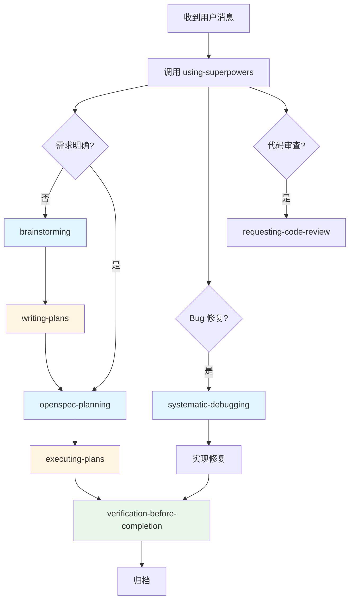
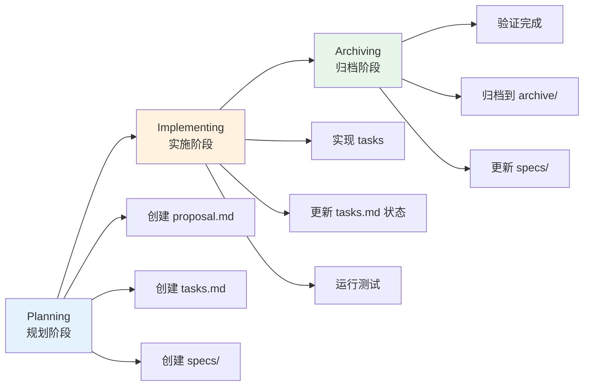
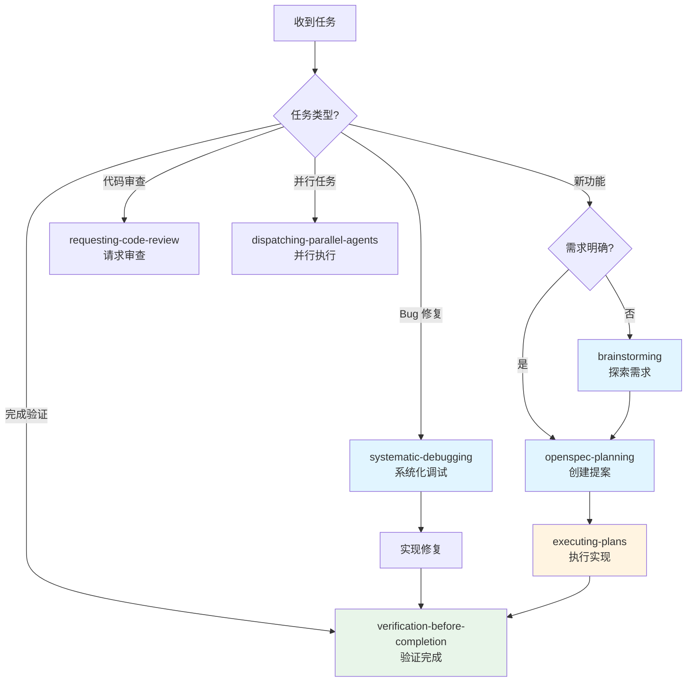

# OpenSpec Reference

<!-- 规范版本: v1.0.0 -->
<!-- 最后更新: 2026-03-06 -->
<!-- 维护者: 开发团队 -->

> **Note**: 本文档为按需参考，agent 默认不读取。使用 `openspec-planning` skill 开始工作流，遇到具体问题时再用 Read 工具读取本文档的相关章节。

## Quick Reference

### CLI Commands

```bash
# Essential commands
openspec list                  # List active changes
openspec list --specs          # List specifications
openspec show [item]           # Display change or spec
openspec validate [item]       # Validate changes or specs
openspec archive <change-id> [--yes|-y]   # Archive after deployment

# Project management
openspec init [path]           # Initialize OpenSpec
openspec update [path]         # Update instruction files

# Debugging
openspec show [change] --json --deltas-only
openspec validate [change] --strict --no-interactive
```

## 工作流程图

### 整体工作流



**图例说明**：
- 蓝色：Process skills（决定如何做）
- 黄色：Implementation skills（指导执行）
- 绿色：Verification skills（验证完成）

### OpenSpec 三阶段流程



**阶段说明**：
- Planning：创建变更提案，定义需求和任务
- Implementing：按 tasks.md 执行实现
- Archiving：验证完成后归档，更新规范

### 技能决策树



**决策说明**：
- 新功能：需求不明确先 brainstorming，明确则直接 openspec-planning
- Bug 修复：使用 systematic-debugging 系统化分析
- 代码审查：使用 requesting-code-review
- 并行任务：使用 dispatching-parallel-agents
- 完成验证：使用 verification-before-completion

## Directory Structure

```
openspec/
├── project.md              # Project conventions
├── specs/                  # Current truth - what IS built
│   └── [capability]/       # Single focused capability
│       ├── spec.md         # Requirements and scenarios
│       └── patterns.md     # Technical patterns (optional)
├── changes/                # Proposals - what SHOULD change
│   ├── [change-name]/      # Format: YYYY-MM-DD-<description>
│   │   ├── proposal.md     # Why, what, impact, metadata
│   │   ├── tasks.md        # Implementation checklist
│   │   ├── design.md       # Technical decisions for this change (optional)
│   │   └── specs/          # Delta changes
│   │       └── [capability]/
│   │           └── spec.md # ADDED/MODIFIED/REMOVED
│   └── archive/            # Completed changes (YYYY-MM-DD-<name>/)
```

## 迁移指南

### 从 docs/plans/ 迁移

**背景**：`docs/plans/` 已废弃，设计文档现在直接创建在 `openspec/changes/<change-id>/design.md`。

**历史文件处理**：
- `docs/plans/` 中的历史文件保留作为参考，不需要迁移
- 新的设计文档直接创建在 `openspec/changes/<change-id>/design.md`
- 如果历史文件对应活跃的 change，可以手动迁移

**如果需要迁移历史文件**：
1. 确定对应的 change-id（如果不存在，创建新的）
2. 创建目录：`mkdir -p openspec/changes/<change-id>`
3. 移动文件：`mv docs/plans/YYYY-MM-DD-<topic>.md openspec/changes/<change-id>/design.md`
4. 调用 openspec-planning 创建其他必需文件

**清理**：
- 可以保留 `docs/plans/` 作为历史记录
- 或者在确认所有活跃 change 都已迁移后删除该目录

---

## 完整示例：从 brainstorming 到实现

### 场景：用户想添加暗黑模式

**步骤 1：brainstorming**
```
用户: "我想添加暗黑模式"
  ↓
Agent 调用 brainstorming skill
  ↓
探索项目上下文（检查现有代码、样式系统）
  ↓
提问澄清（一次一个问题）：
  - "暗黑模式应该如何切换？（按钮/系统偏好/两者）"
  - "是否需要保存用户偏好？"
  - "哪些组件需要支持暗黑模式？"
  ↓
提出 2-3 种方案：
  - 方案 A：CSS 变量（推荐，轻量级）
  - 方案 B：styled-components（更灵活但增加包体积）
  - 方案 C：Tailwind dark mode（需要 Tailwind）
  ↓
用户选择方案 A
  ↓
展示设计（分段获得批准）：
  - 架构：ThemeProvider + CSS 变量
  - 组件：ThemeToggle 按钮
  - 数据流：Context API + localStorage
  - 错误处理：降级到默认主题
  ↓
验证设计完整性（检查清单）
  ↓
所有决策已完成
```

**步骤 2：writing-plans**
```
brainstorming 调用 writing-plans skill
  ↓
Agent 询问 change-id：
  "建议使用 '2026-03-06-add-dark-mode' 作为 change-id，是否同意？"
  ↓
用户确认
  ↓
检查 openspec/changes/2026-03-06-add-dark-mode 是否存在
  ↓
不存在，创建目录
  ↓
创建 openspec/changes/2026-03-06-add-dark-mode/design.md：
  - Context: 用户需求、现有系统
  - Goals: 提供暗黑模式切换
  - Architecture: CSS 变量方案
  - Decisions: 为什么选择 CSS 变量
  - Tech Stack: React Context, CSS Variables
  ↓
保存 design.md
```

**步骤 3：openspec-planning**
```
writing-plans 自动调用 openspec-planning
  ↓
openspec-planning 接收 change-id: "2026-03-06-add-dark-mode"
  ↓
检测到 openspec/changes/2026-03-06-add-dark-mode/design.md 存在
  ↓
读取 design.md 并验证完整性
  ↓
验证通过，创建其他文件：
  ↓
创建 proposal.md：
  ## Metadata
  - Created: 2026-03-06T10:30:00Z
  - Affected Specs:
    - ui-theme (modified: 2026-03-05T15:20:00Z)
  
  ## Why
  用户需要暗黑主题以减少低光环境下的眼睛疲劳
  
  ## What Changes
  - 添加主题切换功能
  - 使用 CSS 变量实现主题切换
  - 添加主题切换按钮
  
  ## Impact
  - Affected specs: ui-theme
  - Affected code: src/components/ThemeProvider.tsx, src/styles/variables.css
  ↓
创建 specs/ui-theme/spec.md：
  ## ADDED Requirements
  
  ### Requirement: 暗黑模式切换
  系统 SHALL 提供暗黑模式切换功能。
  
  #### Scenario: 用户切换到暗黑模式
  - **WHEN** 用户点击主题切换按钮
  - **THEN** 界面切换为暗黑主题
  - **AND** 用户偏好保存到 localStorage
  ↓
创建 tasks.md：
  ## 1. Implementation
  - [ ] 1.1 定义 CSS 变量（亮色/暗色）
  - [ ] 1.2 创建 ThemeProvider 组件
  - [ ] 1.3 创建 ThemeToggle 按钮
  - [ ] 1.4 实现 localStorage 持久化
  - [ ] 1.5 添加测试
  ↓
运行验证：
  openspec validate 2026-03-06-add-dark-mode --strict --no-interactive
  ↓
验证通过
```

**步骤 4：展示并等待批准**
```
Agent 展示给用户：
  "OpenSpec 提案已创建：
  - openspec/changes/2026-03-06-add-dark-mode/proposal.md
  - openspec/changes/2026-03-06-add-dark-mode/design.md
  - openspec/changes/2026-03-06-add-dark-mode/specs/ui-theme/spec.md
  - openspec/changes/2026-03-06-add-dark-mode/tasks.md
  
  验证通过。是否批准开始实现？"
  ↓
用户批准
```

**步骤 5：实现**
```
Agent 创建 TodoWrite 任务（基于 tasks.md）
  ↓
逐个实现任务：
  - 完成 1.1 → 更新 TodoWrite (completed) + tasks.md [x]
  - 完成 1.2 → 更新 TodoWrite (completed) + tasks.md [x]
  - ...
  ↓
所有任务完成
  ↓
运行测试验证
  ↓
提交代码
```

**步骤 6：归档**
```
代码合并到主分支
  ↓
Agent 调用 verification-before-completion
  ↓
运行归档：
  openspec archive 2026-03-06-add-dark-mode --yes
  ↓
更新 openspec/specs/ui-theme/spec.md（合并 delta）
  ↓
提交归档变更
```

---

## Implementation Workflow

### Stage 2: Implementing Changes

#### Task Tracking System

**Two-Level Task System**:
1. **TodoWrite Tool** (Session-level): 用于当前会话的任务规划和进度跟踪
2. **tasks.md File** (Project-level): 用于持久化的项目任务清单

**Critical Rule - Synchronization**:
- 每完成一个任务，必须立即同步更新两个系统
- TodoWrite 标记为 "completed" 时，立即更新 tasks.md 标记为 `[x]`
- 不要等到所有任务完成后再批量更新
- 两个系统必须始终保持同步

#### Implementation Steps

Track these steps as TODOs and complete them one by one:
1. **Read proposal.md** - Understand what's being built
2. **Read design.md** (if exists) - Review technical decisions
3. **Read tasks.md** - Get implementation checklist
4. **Create TodoWrite tasks** - Mirror tasks.md items for session tracking
5. **Implement tasks sequentially** - Complete in order
6. **Update BOTH systems after EACH task** (CRITICAL):
   - Mark TodoWrite as "completed"
   - Immediately mark tasks.md item as `[x]`
   - Do NOT batch updates - update immediately after each task
7. **Verify synchronization** - Ensure TodoWrite and tasks.md match before claiming completion

#### Example Workflow

```
1. 读取 tasks.md: "- [ ] 修改 001-create-sys-user.yaml"
2. 创建 TodoWrite: "修改 001-create-sys-user.yaml" (status: pending)
3. 开始任务: TodoWrite 标记为 in_progress
4. 完成任务:
   a. TodoWrite 标记为 completed
   b. 立即编辑 tasks.md: "- [x] 修改 001-create-sys-user.yaml"
5. 继续下一个任务...
```

#### Red Flags - Task Tracking

| 想法 | 问题 | 正确做法 |
|------|------|---------|
| "我先完成所有任务再更新" | tasks.md 会过时 | 每完成一个立即更新 |
| "TodoWrite 已更新就够了" | 会话结束后丢失 | 必须同步到 tasks.md |
| "批量更新更高效" | 容易遗漏 | 逐个更新更可靠 |
| "任务完成了" | 检查 tasks.md 是否已更新 | 两个系统都要更新 |

### Stage 3: Archiving Changes

After deployment:
- Move `changes/YYYY-MM-DD-[name]/` → `changes/archive/YYYY-MM-DD-[name]/`
- Update `specs/` if capabilities changed:
  - Merge spec.md deltas into `specs/[capability]/spec.md`
  - Add entry to `specs/[capability]/spec.md` Change History section
  - If design.md contains important architectural patterns, extract to `specs/[capability]/patterns.md`
- Update `changes/archive/INDEX.md` with new entry
- Use `openspec archive <change-id> --yes` (always pass the change ID explicitly)
- Run `openspec validate --strict --no-interactive` to confirm the archived change passes checks

**Conflict Detection**:
Before archiving, check if affected specs have been modified since this change was created:
```bash
# Compare spec modification time with change creation time
# If spec is newer, warn about potential conflicts
```

#### 归档决策表

| 条件 | 是否归档 | 说明 |
|------|---------|------|
| 代码已合并到主分支 | 必须 | 代码已进入生产 |
| 所有测试通过 | 必须 | 质量保证 |
| 功能已部署到生产环境 | 必须 | 用户可用 |
| 仅文档变更（无需部署） | 可以 | 文档已更新 |
| 实验性功能（未合并） | 不归档 | 保留在 changes/ |
| tasks.md 有未完成任务 | 不归档 | 先完成所有任务 |

#### 归档前检查清单

在运行 `openspec archive` 前，确认：

- [ ] tasks.md 所有任务标记为 [x]
- [ ] 运行 openspec validate --strict --no-interactive 通过
- [ ] 检查冲突：受影响的 specs/ 文件是否在 change 创建后被修改
- [ ] 更新相关的 specs/ 文件
- [ ] 代码已合并到主分支（如有代码变更）
- [ ] 所有测试通过（如有代码变更）
- [ ] 功能已部署或明确不需要部署

**冲突检测方法**：

归档前自动运行以下检查：

```bash
# 读取 proposal.md 中的 Metadata
# 比较 specs/<capability>/spec.md 的修改时间
# 如果 spec 修改时间晚于 Metadata 中记录的时间，提示冲突

# 示例脚本（归档命令内置）
change_created="2026-03-06T10:00:00Z"
spec_modified=$(stat -f "%Sm" -t "%Y-%m-%dT%H:%M:%SZ" openspec/specs/ui-theme/spec.md)

if [[ "$spec_modified" > "$change_created" ]]; then
  echo "警告：spec 在 change 创建后被修改，可能存在冲突"
  echo "请检查并更新 delta"
  exit 1
fi
```

**运行时机**：
- 自动：`openspec archive` 命令执行时自动检查
- 手动：归档前运行 `openspec validate <change-id> --check-conflicts`

#### 归档命令

```bash
# 归档指定 change
openspec archive <change-id> --yes

# 验证归档结果
openspec validate --strict --no-interactive
ls -la openspec/changes/archive/ | grep <change-id>
```

#### 归档后操作

1. 更新 `openspec/specs/` 中的相关规范：
   - 合并 spec.md delta
   - 在 spec.md 添加 Change History 条目
   - 评估是否需要提取 design.md 到 patterns.md（见下方决策表）
2. 更新 `openspec/changes/archive/INDEX.md`
3. 在 `openspec/CHANGELOG.md` 中记录变更
4. 提交归档变更：
```bash
git add openspec/
git commit -m "chore(openspec): 归档 <change-id>"
```

**design.md → patterns.md 提取决策表**：

| 条件 | 是否提取 | 说明 |
|------|---------|------|
| 引入新的架构模式 | 是 | 如：新的认证方式、缓存策略 |
| 定义长期技术标准 | 是 | 如：API 设计规范、错误处理模式 |
| 重大技术选型决策 | 是 | 如：选择数据库、消息队列 |
| 跨多个 capability 的设计 | 是 | 如：统一的日志格式、监控方案 |
| 一次性实现决策 | 否 | 如：某个功能的具体实现细节 |
| 临时解决方案 | 否 | 如：workaround、临时修复 |
| 已有 patterns.md 覆盖 | 否 | 如：遵循现有模式的实现 |

**提取方法**：
1. 从 `changes/archive/<change-id>/design.md` 中识别长期有效的架构决策
2. 提取到 `specs/<capability>/patterns.md` 的相应章节
3. 在 patterns.md 中引用原始 change：`参考：[2026-03-06-add-auth](../../changes/archive/2026-03-06-add-auth/)`

---

### Proposal Structure

1. **Create directory:** `changes/YYYY-MM-DD-[description]/` (date prefix required, kebab-case, verb-led)

2. **Write proposal.md:**
```markdown
# Change: [Brief description of change]

## Metadata
- Created: YYYY-MM-DDTHH:MM:SSZ
- Affected Specs:
  - [capability-name] (modified: YYYY-MM-DDTHH:MM:SSZ)

## Why
[1-2 sentences on problem/opportunity]

## What Changes
- [Bullet list of changes]
- [Mark breaking changes with **BREAKING**]

## Impact
- Affected specs: [list capabilities]
- Affected code: [key files/systems]
```

3. **Create spec deltas:** `specs/[capability]/spec.md`
```markdown
## ADDED Requirements
### Requirement: New Feature
The system SHALL provide...

#### Scenario: Success case
- **WHEN** user performs action
- **THEN** expected result

## MODIFIED Requirements
### Requirement: Existing Feature
[Complete modified requirement]

## REMOVED Requirements
### Requirement: Old Feature
**Reason**: [Why removing]
**Migration**: [How to handle]
```
If multiple capabilities are affected, create multiple delta files under `changes/[change-id]/specs/<capability>/spec.md`—one per capability.

4. **Create tasks.md:**
```markdown
## 1. Implementation
- [ ] 1.1 Create database schema
- [ ] 1.2 Implement API endpoint
- [ ] 1.3 Add frontend component
- [ ] 1.4 Write tests
```

5. **Create design.md when needed:**
Create `design.md` if any of the following apply; otherwise omit it:
- Cross-cutting change (multiple services/modules) or a new architectural pattern
- New external dependency or significant data model changes
- Security, performance, or migration complexity
- Ambiguity that benefits from technical decisions before coding

**Note**: `design.md` in changes/ documents decisions for THIS change. Long-term architectural patterns go in `specs/[capability]/patterns.md`.

Minimal `design.md` skeleton:
```markdown
## Context
[Background, constraints, stakeholders]

## Goals / Non-Goals
- Goals: [...]
- Non-Goals: [...]

## Decisions
- Decision: [What and why]
- Alternatives considered: [Options + rationale]

## Risks / Trade-offs
- [Risk] → Mitigation

## Migration Plan
[Steps, rollback]

## Open Questions
- [...]
```

## Spec File Format

### Scenario Formatting

**CORRECT**:
```markdown
#### Scenario: User login success
- **WHEN** valid credentials provided
- **THEN** return JWT token
```

Every requirement MUST have at least one scenario using `#### Scenario:` format.

### Delta Operations

- `## ADDED Requirements` - New capabilities
- `## MODIFIED Requirements` - Changed behavior (paste full requirement)
- `## REMOVED Requirements` - Deprecated features
- `## RENAMED Requirements` - Name changes only

**MODIFIED pitfall**: Always include the complete existing requirement text when modifying. Partial updates lose previous details during archiving.

**WRONG** (don't use bullets or bold):
```markdown
- **Scenario: User login**  ❌
**Scenario**: User login     ❌
### Scenario: User login      ❌
```

Every requirement MUST have at least one scenario.

### Requirement Wording
- Use SHALL/MUST for normative requirements (avoid should/may unless intentionally non-normative)

### Delta Operations

- `## ADDED Requirements` - New capabilities
- `## MODIFIED Requirements` - Changed behavior
- `## REMOVED Requirements` - Deprecated features
- `## RENAMED Requirements` - Name changes

Headers matched with `trim(header)` - whitespace ignored.

#### When to use ADDED vs MODIFIED
- ADDED: Introduces a new capability or sub-capability that can stand alone as a requirement. Prefer ADDED when the change is orthogonal (e.g., adding "Slash Command Configuration") rather than altering the semantics of an existing requirement.
- MODIFIED: Changes the behavior, scope, or acceptance criteria of an existing requirement. Always paste the full, updated requirement content (header + all scenarios). The archiver will replace the entire requirement with what you provide here; partial deltas will drop previous details.
- RENAMED: Use when only the name changes. If you also change behavior, use RENAMED (name) plus MODIFIED (content) referencing the new name.

Common pitfall: Using MODIFIED to add a new concern without including the previous text. This causes loss of detail at archive time. If you aren’t explicitly changing the existing requirement, add a new requirement under ADDED instead.

Authoring a MODIFIED requirement correctly:
1) Locate the existing requirement in `openspec/specs/<capability>/spec.md`.
2) Copy the entire requirement block (from `### Requirement: ...` through its scenarios).
3) Paste it under `## MODIFIED Requirements` and edit to reflect the new behavior.
4) Ensure the header text matches exactly (whitespace-insensitive) and keep at least one `#### Scenario:`.

Example for RENAMED:
```markdown
## RENAMED Requirements
- FROM: `### Requirement: Login`
- TO: `### Requirement: User Authentication`
```

## Troubleshooting

### Common Validation Errors

- **"Change must have at least one delta"**: Check `changes/[name]/specs/` has .md files with `## ADDED/MODIFIED/REMOVED Requirements`
- **"Requirement must have at least one scenario"**: Use `#### Scenario:` format (4 hashtags)
- **Silent parsing failures**: Debug with `openspec show [change] --json --deltas-only`

### Validation Commands

```bash
openspec validate [change] --strict --no-interactive
openspec show [change] --json --deltas-only
```

## Best Practices

### Naming Conventions
- **Change IDs**: `YYYY-MM-DD-<description>` (date prefix required, kebab-case, verb-led)
  - Example: `2026-03-06-add-dark-mode`
  - Ensures uniqueness and natural sorting
- **Capabilities**: verb-noun (`user-auth`, `payment-capture`)

### Simplicity First
- Default to <100 lines of new code
- Single-file implementations until proven insufficient
- Choose boring, proven patterns

### Clear References
- Code locations: `file.ts:42`
- Specs: `specs/auth/spec.md`

### Missing Context
1. Read project.md first
2. Check related specs
3. Review recent archives
4. Ask for clarification

## Quick Reference

### Stage Indicators
- `changes/` - Proposed, not yet built
- `specs/` - Built and deployed
- `archive/` - Completed changes

### File Purposes
- `proposal.md` - Why and what
- `tasks.md` - Implementation steps
- `design.md` - Technical decisions
- `spec.md` - Requirements and behavior

### CLI Essentials
```bash
openspec list              # What's in progress?
openspec show [item]       # View details
openspec validate --strict --no-interactive  # Is it correct?
openspec archive <change-id> [--yes|-y]  # Mark complete (add --yes for automation)
```

Remember: Specs are truth. Changes are proposals. Keep them in sync.
