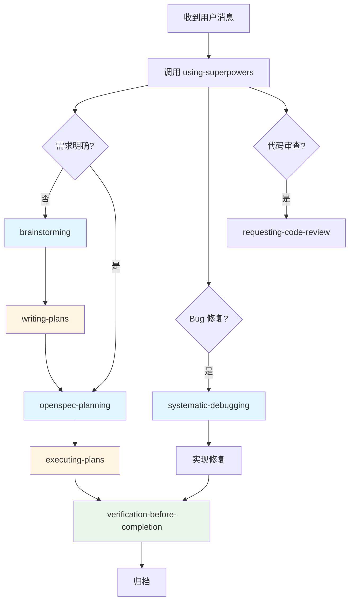
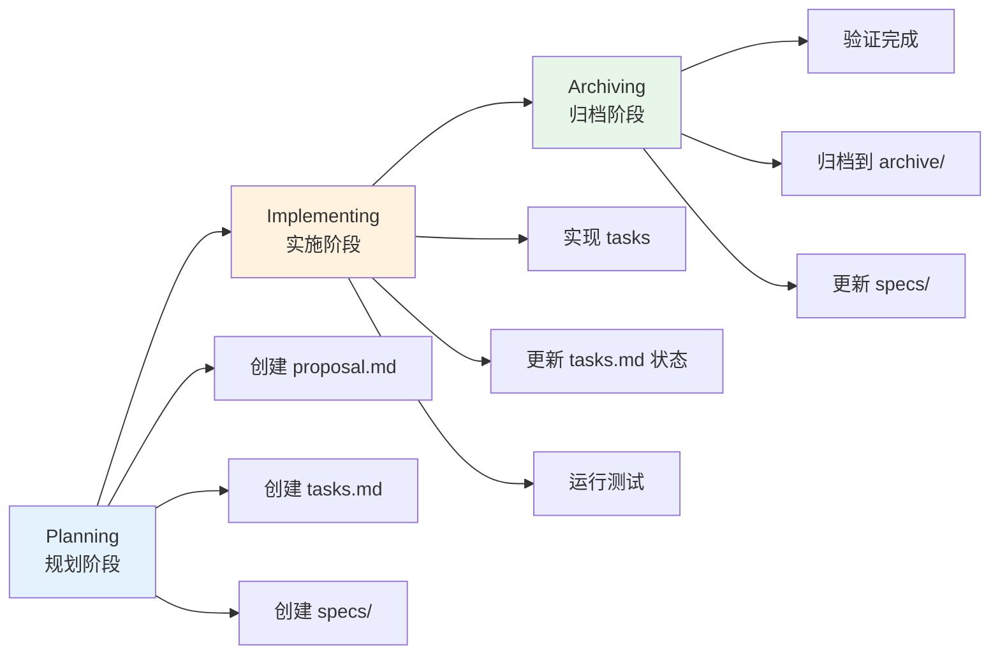
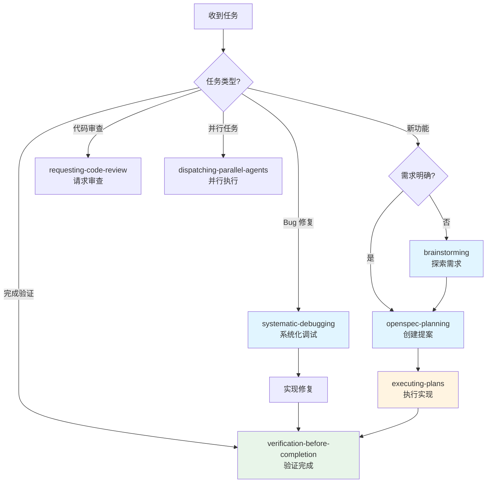

# OpenSpec Reference

<!-- 规范版本: v1.0.0 -->
<!-- 最后更新: 2026-03-06 -->
<!-- 维护者: 开发团队 -->

> **Note**: 本文档为按需参考，agent 默认不读取。使用 `openspec-planning` skill 开始工作流，遇到具体问题时再用 Read 工具读取本文档的相关章节。

## Quick Reference

### CLI Commands

```bash
# Essential commands
openspec list                  # List active changes
openspec list --specs          # List specifications
openspec show [item]           # Display change or spec
openspec validate [item]       # Validate changes or specs
openspec archive <change-id> [--yes|-y]   # Archive after deployment

# Project management
openspec init [path]           # Initialize OpenSpec
openspec update [path]         # Update instruction files

# Debugging
openspec show [change] --json --deltas-only
openspec validate [change] --strict --no-interactive
```

## 工作流程图

### 整体工作流



**图例说明**：
- 蓝色：Process skills（决定如何做）
- 黄色：Implementation skills（指导执行）
- 绿色：Verification skills（验证完成）

### OpenSpec 三阶段流程



**阶段说明**：
- Planning：创建变更提案，定义需求和任务
- Implementing：按 tasks.md 执行实现
- Archiving：验证完成后归档，更新规范

### 技能决策树



**决策说明**：
- 新功能：需求不明确先 brainstorming，明确则直接 openspec-planning
- Bug 修复：使用 systematic-debugging 系统化分析
- 代码审查：使用 requesting-code-review
- 并行任务：使用 dispatching-parallel-agents
- 完成验证：使用 verification-before-completion

## Directory Structure

```
openspec/
├── project.md              # Project conventions
├── specs/                  # Current truth - what IS built
│   └── [capability]/       # Single focused capability
│       ├── spec.md         # Requirements and scenarios
│       └── design.md       # Technical patterns
├── changes/                # Proposals - what SHOULD change
│   ├── [change-name]/
│   │   ├── proposal.md     # Why, what, impact
│   │   ├── tasks.md        # Implementation checklist
│   │   ├── design.md       # Technical decisions (optional)
│   │   └── specs/          # Delta changes
│   │       └── [capability]/
│   │           └── spec.md # ADDED/MODIFIED/REMOVED
│   └── archive/            # Completed changes
```

## Implementation Workflow

### Stage 2: Implementing Changes

Track these steps as TODOs and complete them one by one:
1. **Read proposal.md** - Understand what's being built
2. **Read design.md** (if exists) - Review technical decisions
3. **Read tasks.md** - Get implementation checklist
4. **Implement tasks sequentially** - Complete in order
5. **Confirm completion** - Ensure every item in `tasks.md` is finished before updating statuses
6. **Update checklist** - After all work is done, set every task to `- [x]`

### Stage 3: Archiving Changes

After deployment:
- Move `changes/[name]/` → `changes/archive/YYYY-MM-DD-[name]/`
- Update `specs/` if capabilities changed
- Use `openspec archive <change-id> --yes` (always pass the change ID explicitly)
- Run `openspec validate --strict --no-interactive` to confirm the archived change passes checks

#### 归档决策表

| 条件 | 是否归档 | 说明 |
|------|---------|------|
| 代码已合并到主分支 | 必须 | 代码已进入生产 |
| 所有测试通过 | 必须 | 质量保证 |
| 功能已部署到生产环境 | 必须 | 用户可用 |
| 仅文档变更（无需部署） | 可以 | 文档已更新 |
| 实验性功能（未合并） | 不归档 | 保留在 changes/ |
| tasks.md 有未完成任务 | 不归档 | 先完成所有任务 |

#### 归档前检查清单

在运行 `openspec archive` 前，确认：

- [ ] tasks.md 所有任务标记为 [x]
- [ ] 运行 openspec validate --strict --no-interactive 通过
- [ ] 更新相关的 specs/ 文件
- [ ] 代码已合并到主分支（如有代码变更）
- [ ] 所有测试通过（如有代码变更）
- [ ] 功能已部署或明确不需要部署

#### 归档命令

```bash
# 归档指定 change
openspec archive <change-id> --yes

# 验证归档结果
openspec validate --strict --no-interactive
ls -la openspec/changes/archive/ | grep <change-id>
```

#### 归档后操作

1. 更新 `openspec/specs/` 中的相关规范
2. 在 `openspec/CHANGELOG.md` 中记录变更
3. 提交归档变更：
```bash
git add openspec/
git commit -m "chore(openspec): 归档 <change-id>"
```

---

### Proposal Structure

1. **Create directory:** `changes/[change-id]/` (kebab-case, verb-led, unique)

2. **Write proposal.md:**
```markdown
# Change: [Brief description of change]

## Why
[1-2 sentences on problem/opportunity]

## What Changes
- [Bullet list of changes]
- [Mark breaking changes with **BREAKING**]

## Impact
- Affected specs: [list capabilities]
- Affected code: [key files/systems]
```

3. **Create spec deltas:** `specs/[capability]/spec.md`
```markdown
## ADDED Requirements
### Requirement: New Feature
The system SHALL provide...

#### Scenario: Success case
- **WHEN** user performs action
- **THEN** expected result

## MODIFIED Requirements
### Requirement: Existing Feature
[Complete modified requirement]

## REMOVED Requirements
### Requirement: Old Feature
**Reason**: [Why removing]
**Migration**: [How to handle]
```
If multiple capabilities are affected, create multiple delta files under `changes/[change-id]/specs/<capability>/spec.md`—one per capability.

4. **Create tasks.md:**
```markdown
## 1. Implementation
- [ ] 1.1 Create database schema
- [ ] 1.2 Implement API endpoint
- [ ] 1.3 Add frontend component
- [ ] 1.4 Write tests
```

5. **Create design.md when needed:**
Create `design.md` if any of the following apply; otherwise omit it:
- Cross-cutting change (multiple services/modules) or a new architectural pattern
- New external dependency or significant data model changes
- Security, performance, or migration complexity
- Ambiguity that benefits from technical decisions before coding

Minimal `design.md` skeleton:
```markdown
## Context
[Background, constraints, stakeholders]

## Goals / Non-Goals
- Goals: [...]
- Non-Goals: [...]

## Decisions
- Decision: [What and why]
- Alternatives considered: [Options + rationale]

## Risks / Trade-offs
- [Risk] → Mitigation

## Migration Plan
[Steps, rollback]

## Open Questions
- [...]
```

## Spec File Format

### Scenario Formatting

**CORRECT**:
```markdown
#### Scenario: User login success
- **WHEN** valid credentials provided
- **THEN** return JWT token
```

Every requirement MUST have at least one scenario using `#### Scenario:` format.

### Delta Operations

- `## ADDED Requirements` - New capabilities
- `## MODIFIED Requirements` - Changed behavior (paste full requirement)
- `## REMOVED Requirements` - Deprecated features
- `## RENAMED Requirements` - Name changes only

**MODIFIED pitfall**: Always include the complete existing requirement text when modifying. Partial updates lose previous details during archiving.

**WRONG** (don't use bullets or bold):
```markdown
- **Scenario: User login**  ❌
**Scenario**: User login     ❌
### Scenario: User login      ❌
```

Every requirement MUST have at least one scenario.

### Requirement Wording
- Use SHALL/MUST for normative requirements (avoid should/may unless intentionally non-normative)

### Delta Operations

- `## ADDED Requirements` - New capabilities
- `## MODIFIED Requirements` - Changed behavior
- `## REMOVED Requirements` - Deprecated features
- `## RENAMED Requirements` - Name changes

Headers matched with `trim(header)` - whitespace ignored.

#### When to use ADDED vs MODIFIED
- ADDED: Introduces a new capability or sub-capability that can stand alone as a requirement. Prefer ADDED when the change is orthogonal (e.g., adding "Slash Command Configuration") rather than altering the semantics of an existing requirement.
- MODIFIED: Changes the behavior, scope, or acceptance criteria of an existing requirement. Always paste the full, updated requirement content (header + all scenarios). The archiver will replace the entire requirement with what you provide here; partial deltas will drop previous details.
- RENAMED: Use when only the name changes. If you also change behavior, use RENAMED (name) plus MODIFIED (content) referencing the new name.

Common pitfall: Using MODIFIED to add a new concern without including the previous text. This causes loss of detail at archive time. If you aren’t explicitly changing the existing requirement, add a new requirement under ADDED instead.

Authoring a MODIFIED requirement correctly:
1) Locate the existing requirement in `openspec/specs/<capability>/spec.md`.
2) Copy the entire requirement block (from `### Requirement: ...` through its scenarios).
3) Paste it under `## MODIFIED Requirements` and edit to reflect the new behavior.
4) Ensure the header text matches exactly (whitespace-insensitive) and keep at least one `#### Scenario:`.

Example for RENAMED:
```markdown
## RENAMED Requirements
- FROM: `### Requirement: Login`
- TO: `### Requirement: User Authentication`
```

## Troubleshooting

### Common Validation Errors

- **"Change must have at least one delta"**: Check `changes/[name]/specs/` has .md files with `## ADDED/MODIFIED/REMOVED Requirements`
- **"Requirement must have at least one scenario"**: Use `#### Scenario:` format (4 hashtags)
- **Silent parsing failures**: Debug with `openspec show [change] --json --deltas-only`

### Validation Commands

```bash
openspec validate [change] --strict --no-interactive
openspec show [change] --json --deltas-only
```

## Best Practices

### Naming Conventions
- **Change IDs**: kebab-case, verb-led (`add-dark-mode`, `update-auth-flow`)
- **Capabilities**: verb-noun (`user-auth`, `payment-capture`)

### Simplicity First
- Default to <100 lines of new code
- Single-file implementations until proven insufficient
- Choose boring, proven patterns

### Clear References
- Code locations: `file.ts:42`
- Specs: `specs/auth/spec.md`

### Missing Context
1. Read project.md first
2. Check related specs
3. Review recent archives
4. Ask for clarification

## Quick Reference

### Stage Indicators
- `changes/` - Proposed, not yet built
- `specs/` - Built and deployed
- `archive/` - Completed changes

### File Purposes
- `proposal.md` - Why and what
- `tasks.md` - Implementation steps
- `design.md` - Technical decisions
- `spec.md` - Requirements and behavior

### CLI Essentials
```bash
openspec list              # What's in progress?
openspec show [item]       # View details
openspec validate --strict --no-interactive  # Is it correct?
openspec archive <change-id> [--yes|-y]  # Mark complete (add --yes for automation)
```

Remember: Specs are truth. Changes are proposals. Keep them in sync.
